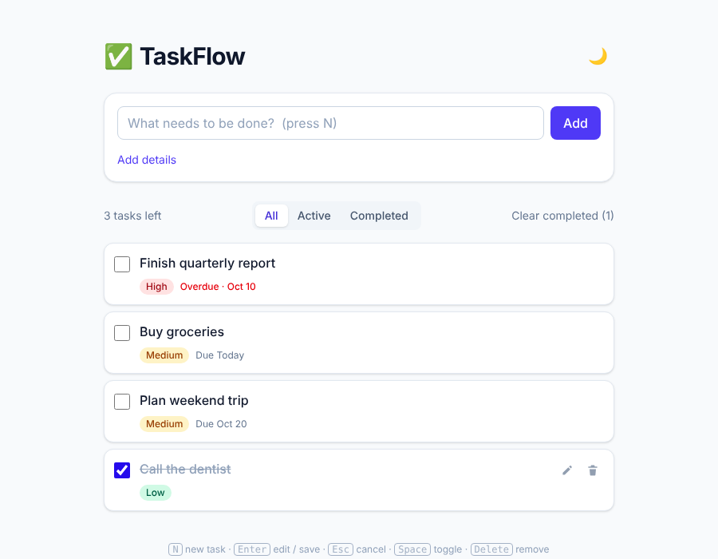

# ✅ TaskFlow — A Simple To-Do Web App

A clean, fast, and responsive to-do list web application that helps you organize tasks, track progress, and stay productive.


> Replace `TaskFlow` and the placeholder links below with your project's name and URLs.

---

## 📸 Preview



**Live demo:** [your-app-url.com](https://your-app-url.com)

---

## ✨ Features

- ➕ **Add tasks** with a title and optional description
- ✏️ **Edit tasks** inline
- ✔️ **Mark tasks complete** / incomplete
- 🗑️ **Delete tasks** individually or clear all completed
- 🔍 **Filter** by All, Active, or Completed
- 📅 **Due dates** and priority levels (Low / Medium / High), with overdue highlighting
- 💾 **Persistent storage** — tasks survive page reloads
- 🌙 **Light and dark mode** (follows your system setting until you choose)
- 📱 **Fully responsive** on mobile, tablet, and desktop
- ♿ **Accessible** — keyboard navigation and screen-reader friendly

---

## 🛠️ Tech Stack

| Layer      | Technology                                   |
|------------|----------------------------------------------|
| Frontend   | React + Vite                                 |
| Styling    | Tailwind CSS                                 |
| State      | React Hooks / Context API                    |
| Storage    | localStorage (or REST API backend)           |
| Backend*   | Node.js + Express                            |
| Database*  | JSON file (swap in MongoDB / PostgreSQL)     |
| Testing    | Vitest + React Testing Library + Supertest   |

\* Optional — only if you run the full-stack version.

---

## 🚀 Getting Started

### Prerequisites

- [Node.js](https://nodejs.org/) v20.12 or higher
- npm (comes with Node) or yarn

### Installation

1. **Clone the repository**
   ```bash
   git clone https://github.com/your-username/taskflow.git
   cd taskflow
   ```

2. **Install dependencies**
   ```bash
   npm install
   ```

3. **Set up environment variables** (only needed for the backend version)

   Copy `.env.example` to `.env`:
   ```env
   PORT=5000
   DATABASE_URL=./server/data/tasks.json
   VITE_API_URL=http://localhost:5000/api
   ```
   When `VITE_API_URL` is set, the frontend stores tasks via the API instead of localStorage.

4. **Start the development server**
   ```bash
   npm run dev
   ```
   For the full-stack version, also start the API in another terminal:
   ```bash
   npm run server
   ```

5. Open [http://localhost:5173](http://localhost:5173) in your browser.

---

## 📜 Available Scripts

| Command           | Description                              |
|-------------------|------------------------------------------|
| `npm run dev`     | Start the development server             |
| `npm run build`   | Build the app for production             |
| `npm run preview` | Preview the production build locally     |
| `npm run server`  | Start the optional Express API           |
| `npm test`        | Run the test suite                       |
| `npm run lint`    | Check code for linting errors            |

---

## 📁 Project Structure

```
taskflow/
├── public/               # Static assets
├── src/
│   ├── components/       # Reusable UI components
│   │   ├── TaskItem.jsx
│   │   ├── TaskList.jsx
│   │   ├── TaskForm.jsx
│   │   └── FilterBar.jsx
│   ├── context/          # Global state (TaskContext + reducer)
│   ├── hooks/            # Custom hooks (useLocalStorage, useTheme)
│   ├── utils/            # Task helpers, API client, shared styles
│   ├── App.jsx
│   └── main.jsx
├── server/               # Optional backend
│   ├── routes/
│   ├── models/
│   └── index.js
├── tests/
├── .env.example
├── package.json
└── README.md
```

---

## 🔌 API Endpoints (Backend Version)

| Method | Endpoint          | Description           |
|--------|-------------------|-----------------------|
| GET    | `/api/tasks`      | Get all tasks         |
| GET    | `/api/tasks/:id`  | Get a single task     |
| POST   | `/api/tasks`      | Create a new task     |
| PUT    | `/api/tasks/:id`  | Update a task         |
| DELETE | `/api/tasks/:id`  | Delete a task         |

`PUT` accepts a partial task (e.g. `{ "completed": true }`). Invalid input returns `400`, unknown ids return `404`.

**Example task object:**
```json
{
  "id": "a1b2c3",
  "title": "Buy groceries",
  "description": "Milk, eggs, bread",
  "completed": false,
  "priority": "medium",
  "dueDate": "2026-10-20",
  "createdAt": "2026-10-14T09:30:00Z"
}
```

---

## ⌨️ Keyboard Shortcuts

| Shortcut         | Action                                    |
|------------------|-------------------------------------------|
| `N`              | Focus the new-task input                  |
| `Enter`          | Save task (or start editing a focused task) |
| `Esc`            | Cancel editing                            |
| `Space`          | Toggle the focused task complete          |
| `Delete`         | Delete the focused task                   |

Use `Tab` to move focus between tasks.

---

## 🧪 Running Tests

```bash
npm test
```

To view coverage:
```bash
npm test -- --coverage
```

---

## 🌐 Deployment

The frontend can be deployed to any static host:

- **Vercel:** `vercel deploy`
- **Netlify:** drag and drop the `dist/` folder, or connect your repo
- **GitHub Pages:** build with `npm run build` and publish the `dist/` folder

For the full-stack version, deploy the backend to a service like Render, Railway, or Fly.io and set `VITE_API_URL` at build time accordingly.

---

## 🗺️ Roadmap

- [ ] User authentication and accounts
- [ ] Drag-and-drop task reordering
- [ ] Categories and tags
- [ ] Recurring tasks
- [ ] Reminders and notifications
- [ ] Sync across devices
- [ ] Export tasks to CSV

---

## 🤝 Contributing

Contributions are welcome!

1. Fork the repository
2. Create a feature branch: `git checkout -b feature/amazing-feature`
3. Commit your changes: `git commit -m "Add amazing feature"`
4. Push to the branch: `git push origin feature/amazing-feature`
5. Open a Pull Request

Please make sure your code passes linting and tests before submitting.

---

## 📄 License

This project is licensed under the MIT License — see the [LICENSE](./LICENSE) file for details.

---

## 👤 Author

**Your Name**
- GitHub: [@your-username](https://github.com/your-username)
- Email: your.email@example.com

---

⭐ If you found this project helpful, consider giving it a star!
